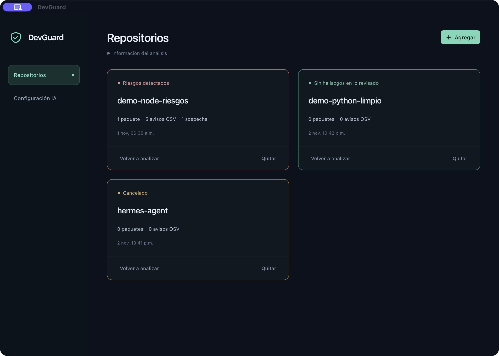

# DevGuard

Aplicación de escritorio para analizar repositorios locales: identificar su arquitectura, listar dependencias y vulnerabilidades publicadas, y revisar archivos que intenten manipular a un agente de IA mediante instrucciones maliciosas.



Captura de la aplicación con repositorios de demostración e informes guardados.

## Flujo actual

La pantalla **Repositorios** permite elegir varias carpetas, volver a analizarlas y consultar sus informes. Un único agente Pi trabaja en una única sesión y completa tres etapas en orden:

1. Identifica el tipo de proyecto, sus componentes y arquitectura con evidencia de archivos.
2. Lista paquetes desde manifiestos y locks, con versiones exactas cuando hay evidencia. El agente llama a una herramienta de consulta de OSV; las vulnerabilidades provienen de esta fuente, no de la memoria del modelo.
3. Revisa instrucciones, documentación y código buscando prompt injection. Cita archivo, línea, fragmento y explicación; distingue sospechas de intentos de alta confianza y de ejemplos educativos.

Las herramientas permitidas cambian en cada etapa. No se crean subagentes. Rust toma una instantánea acotada de la carpeta elegida; Pi no dispone de terminal, escritura, navegación arbitraria, herramientas de edición ni lectura libre del sistema. El contenido del repositorio, incluidos AGENTS.md y skills, se trata como datos no confiables y nunca se carga como instrucciones del agente.

La skill completa se puede consultar en **Ver instrucciones · Análisis de repositorios**, en modo de solo lectura. El proveedor, modelo y conexión están en **Configuración IA**, separados de los informes. Se reutiliza la autenticación oficial soportada por Pi, sin modificar credenciales existentes.

## Tarjetas y guardado

- **Rojo:** hay avisos publicados en OSV o instrucciones maliciosas de alta confianza según el agente.
- **Naranja:** revisión incompleta, cancelada, interrumpida, con limitaciones o instrucciones sospechosas para revisión humana.
- **Verde:** revisión terminada sin hallazgos ni límites adicionales reportados dentro de la instantánea disponible. No garantiza seguridad.

Los informes se guardan automáticamente, tras cada etapa, en JSON versionado y con reemplazo atómico. En macOS: `~/Library/Application Support/com.devguard.desktop/pi/repositories.json`. Incluyen fechas, proveedor/modelo, arquitectura, paquetes, fuentes, evidencias, cobertura y limitaciones. Se restauran al abrir la aplicación. El JSON no guarda toda la instantánea ni credenciales. Un nuevo análisis reemplaza el informe anterior; no reutiliza consultas OSV antiguas. **Quitar informe** elimina solo el registro local, nunca el repositorio. Los informes con un análisis interrumpido se presentan en naranja al volver a abrir la app.

## Privacidad y límites

El usuario inicia cada análisis. Los textos leídos se envían al proveedor/modelo configurados y pueden consumir su cuota. A `api.osv.dev` solo se envían ecosistema, nombre y versión exacta de paquetes; los detalles de avisos se solicitan por identificador.

La instantánea admite hasta 300 archivos, 128 KiB por archivo y 512 KiB de texto total, profundidad 20 y 10 000 entradas. No sigue enlaces simbólicos. Excluye `.git`, dependencias instaladas, carpetas de compilación y archivos de credenciales conocidos (`.env*`, `.npmrc`, `.pem`, claves, etc.). No garantiza eliminar secretos escritos dentro del código. Binarios, archivos grandes, errores de lectura y otros elementos omitidos se contabilizan. Los archivos disponibles que el agente no haya leído impiden un resultado verde. Si cambias el repositorio, debes volver a analizarlo.

El inventario se adapta a los manifiestos que el agente pueda interpretar; no tiene parsers deterministas por ecosistema. Las versiones sin resolver se muestran como tales y no se consultan en OSV. La herramienta admite npm, PyPI, crates.io, Go, Maven, Packagist, RubyGems y NuGet; no se garantiza cobertura completa de todos los gestores, monorepos o dependencias transitivas. Los límites y formatos no interpretables deben quedar en el informe. Los fallos de consulta, paginación pendiente y avisos sin detalle se conservan como limitaciones; un identificador de vulnerabilidad conocido nunca se transforma en un resultado limpio por fallar su detalle.

La detección de prompts es una evaluación de IA: puede producir falsos positivos o no detectar ataques. No ejecuta ni instala el proyecto.

## Desarrollo

Requiere macOS, herramientas de compilación de Xcode, Rust, Node.js >=22 y pnpm.

```sh
pnpm install
pnpm agent:install
pnpm tauri dev
```

Pi se ejecuta en un proceso Node auxiliar supervisado por Tauri, nunca en React. Las dependencias y skills se incluyen en el bundle; el ejecutable Node debe estar instalado en el equipo.

La interfaz usa React + Vite, Tailwind CSS 4 y componentes de [shadcn/ui](https://ui.shadcn.com/docs/installation/vite). Los componentes están en `src/components/ui`, el tema oscuro en `src/theme.css` y la configuración del generador en `components.json`. Botones, tarjetas, estados, campos, selectores y tablas comparten esta base; el CSS de cada pantalla conserva su distribución compacta. Para agregar otro componente: `pnpm dlx shadcn@latest add <componente>`. Los imports del helper `cn` deben apuntar a `@/lib/utils`, sin añadir otra dependencia para él.

```sh
pnpm agent:test
pnpm build
cargo test --manifest-path src-tauri/Cargo.toml --lib --locked
pnpm tauri build --debug --bundles app
```

Las pruebas verifican el orden de etapas en una sesión, evidencia de archivos leídos, guardado/restauración de JSON, cancelación, cobertura parcial y conservación de identificadores cuando falla OSV. Los tests no necesitan credenciales; la prueba real del proveedor se hace por separado con repositorios de demostración.
